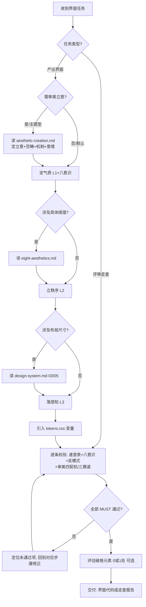

# evan-design · WorkBuddy 视觉与界面设计规范

## 〇、美学总纲（ember-art-solution 统摄 · v2.2.0）

**本 skill 是 `ember-art-solution`（美学主导全场景方案总控，v1.2.0）在 互联网产品 UI（J） 领域的执行端。** 总控负责统一的体系定位、色板、形式语法与质量门禁；本 skill 保留全部原有领域主干与数值规范。完整接入说明见 `references/art-solution/bridge.md`。

### 0.1 新增前置动作 · 美学体系定位（不得跳过）

在原有工作流最前面执行：从用户给的「风格 / 氛围 / 感觉」或内容题材，按 `references/art-solution/core-01-style-router.md` S1–S5 产出**美学定位卡摘要**——主体系（东方 / 西方 / 阿拉伯-伊斯兰）→ 三级流派（`core-00`）→ 底层逻辑四条（色彩观念 / 光影处理 / 空间构图 / 终极目标）→ 主情绪与审美形态（`core-06`）→ 色板（色名＋HEX，`core-03`）→ 目标观者反应。
用户未给风格或说「根据内容制定」时，按 `core-01` §5 五步缺省推断并标注〔推断〕，**不打断追问**。

### 0.2 执行时的三处接入

1. **参数映射阶段**：在既有情绪/形态同向性之外，追加「体系→L0 立意 / L1 气质 / L2 秩序 / L3 感知 同向性」，逐项核对 `core-00` 第三部分；冲突时以体系逻辑裁决，若刻意反向须写明目的。
2. **创作深化阶段**：调用 `core-07` 三层递进、意境四步、象征回环；`core-04` 六法与留白三法；`core-08` 八意识。
3. **交付校验阶段**：在既有校验清单之外，追加 `core-10` 三重门禁中的「体系一致性」10 条，重点排查：东方主题用西方强明暗、伊斯兰主题加大留白、符号堆砌替代底层逻辑、色值不可溯源。

### 0.3 冲突裁决（重要）

**数值与合规永远优先**：本 skill 仍是 WorkBuddy 视觉语言的唯一数值权威，三层内核、L0 六步法、八意识量化阈值、Token 与对比度实测表一律不改；可用性（WCAG 2.1 AA、《用户体验的要素》五层模型）优先 ＞ 体系逻辑 ＞ 审美立意。切换体系不修改既有 Token 结构。

### 0.4 组合交付

若用户同时要多个产品（如「一套网站加海报、封面与品牌文案」），或只给「感觉」不给领域参数，**转由 `ember-art-solution` 总控**做组合交付，共享同一张美学定位卡；本 skill 只负责其中的 互联网产品 UI（J） 子件。

### 0.5 总纲资源（`references/art-solution/`）

| 文件 | 用途 |
|---|---|
| `core-00-architecture.md` | 美学分类组织架构总表：三大体系 15 流派、风格 vs 派别、底层逻辑对照（**最高依据**） |
| `core-01-style-router.md` | 风格/氛围/感觉 → 美学定位卡、词库、五步定位、缺省推断 |
| `core-02-delivery-matrix.md` | 14 类交付矩阵、P1–P8 主流程、组合交付 |
| `core-03-color-system.md` | 三套传统色库（中国 526 / 日式 250 / 伊斯兰 30）、取色五步法 |
| `core-04-visual-form.md` | 画面审美六法、留白三法、跨媒介转译 |
| `core-05-theory-index.md` | 22 册理论原典与应用场景资料索引（21 册已有全文 TXT） |
| `core-05-theory-digest.md` | **全文核实的精炼结论库**：22 册合并为 T1–T9 九族、可执行转译参数与来源标注 |
| `core-06-aesthetic-forms.md` | 六大审美形态、情绪→形态、全案节奏、同向性 |
| `core-07-creative-method.md` | 三层递进、美感六机制、意境四步、象征四法、六步创作法 |
| `core-08-eight-aesthetics.md` | 八意识跨媒介裁决表与联检清单 |
| `core-09-emotion-sensory.md` | 八大情绪词族 → 全感官参数、通感、声音留白 |
| `core-10-quality-gate.md` | 三重质量门禁、可用性硬指标、交付总清单 |
| `scene-11-space.md` / `scene-12-audio.md` / `scene-13-graphic.md` | 空间 / 声景 / 平面三类扩展场景 |
| `bridge.md` | **本 skill 专属接入桥**：体系→本领域参数传导表、对照索引、裁决口径 |

> `assets/art-solution-template.md` 为跨场景通用交付骨架，组合交付时使用。

---

## 〇之二、知识库融合（K 层 · v2.2.0）

本 skill 已融合 `references/knowledge/` 下三份精炼知识库，作为**通用创作规则 + 领域可执行硬参数**横切既有工作流。
完整章节路由、相似信息合并对照与冲突裁决见 `references/knowledge/KNOWLEDGE-INTEGRATION.md`（**接入前必读**）。

| 文件 | 本 skill 中的角色 |
|---|---|
| `knowledge/aesthetics-art.md` | **本领域主库**：美学底层逻辑、设计／配色／字体版式、检查清单与自检 30 条 |
| `knowledge/photography.md` | 跨媒介视觉参考（光影、构图、色彩管理），不作 UI 数值依据 |
| `knowledge/film-video.md` | 跨媒介参考（时序节奏、声画、竖屏），不作 UI 数值依据 |
| `knowledge/KNOWLEDGE-INTEGRATION.md` | **融合总纲**：章节路由、相似信息合并对照、冲突裁决表、门禁追加项 |

### K.1 三个接入点（MUST）

1. **步骤 2 定立意**：用美学艺术类第一篇把「好看」拆成可论证的价值路径与心理机制。
2. **步骤 4–5**：用第二篇第七／十一／十二／十三章补形式论证，但所有数值仍取 Token。
3. **步骤 6**：在既有速查表 + 八意识联检 + 反模式之外，追加自检 30 条中界面相关项。

### K.2 按需读取（MUST NOT）

不要把三份库全文塞进上下文。按 `KNOWLEDGE-INTEGRATION.md` 第二节的章节路由，只读取当前阶段对应章节。

### K.3 冲突裁决摘要

- **新库给出的色值／字号／间距／比例与本 skill Token 不一致** → **一律以 assets/tokens.css 与 design-system.md 实测表为准**（本 skill 是 WorkBuddy 视觉语言唯一数值权威）
- **新库提到 WCAG 2.2 而本 skill 规定 2.1 AA** → 2.1 AA 为 MUST 底线；2.2 新增条目可作增强建议，不得据此放宽 2.1 AA（第六节 MUST）
- **新库「破格／张力」表述与八意识「破至多 1 处、其余 100% 合规」冲突** → 以八意识联检为准（1.2 冲突裁决口径）

### K.4 质量门禁追加（在既有校验之后执行）

- [ ] 灰阶层级是否先于色相检查（自检 30 条第 18 条）
- [ ] 字体是否完成真实词组／小字号／全字符／混排／授权测试（第 19 条）
- [ ] 五秒内是否有唯一视觉入口、一分钟内能否理解主要关系（第 15 条）
- [ ] 信息是否不只依赖颜色／悬停／运动并具备等价通道（第 23 条）

---

## Overview

本 skill 是 WorkBuddy 视觉语言的唯一参考源。任何界面产出（原型、切图、代码实现、走查报告）都必须逐条对照下方「设计决策速查表」（第四节）校验。当具体数值之间出现分歧时，以本文件的**设计哲学内核（第一节）**为准，而非某一孤立数值。所有规则的表述口径以本文件与 `references/` 三份文档**互相引用的一致性条款**为准（见 1.2 冲突裁决）。

## When to Use

- 新建或修改任何界面：Web 应用、桌面客户端、移动端、落地页、仪表盘
- 编写或重构前端样式（HTML/CSS/组件库/设计 token）
- 做原型或高保真设计稿、选择配色/字体/间距/圆角/阴影/动效
- UI 走查、设计评审、无障碍（对比度/触摸目标）检查
- 用户提到「按 WorkBuddy 风格」「东方美学」「留白」「黄金分割」等设计诉求
- 需要为方案补充审美立意、境界定位、美学论证或创作说明（L0 层，见 1.3 节）

## 前置条件（Prerequisites）

**外部依赖：无。** 本技能是纯知识 + CSS 资产型技能，运行时**不需要**任何 MCP 服务、API Key、网络请求或特定环境变量。安装后即可直接使用，不存在因缺少密钥或连接器而无法工作的情况。

| 项目 | 是否必需 | 说明 |
|------|---------|------|
| MCP 服务 | 否 | 不调用任何 MCP 工具 |
| API Key / Token | 否 | 无外部 API 调用 |
| 网络访问 | 否 | 规范与 Token 全部内置于技能包 |
| 特定运行环境 | 否 | 纯文本 + CSS，跨平台可用 |

**使用时的可选条件（非安装前置）：**

- **产出 CSS 代码时**：将 `assets/tokens.css` 引入或复制到目标项目；若项目使用 CSS-in-JS / Tailwind / SCSS，需把 Token 变量映射到对应体系，而非直接 `<link>`。
- **字体还原**：规范指定的思源宋体/黑体、霞鹜文楷、Inter、EB Garamond 需目标环境可用；若无，按字体栈回退即可，不影响技能加载与规范判定。
- **纸张噪点材质**：`tokens.css` 中的 `--noise-opacity` 仅为数值令牌，实际噪点贴图由目标项目提供（可用 CSS `url()` 或内联 SVG）；不影响无材质场景。
- **版本**：当前 1.3.0；变更记录见 `CHANGELOG.md` 与第七节。后续重大设计决策按第七节追加条目并递增版本。

## 一、设计哲学内核（决策最高准则）

WorkBuddy 的美学不是风格的堆叠，而是三层递进：

| 层级 | 内容 | 回答的问题 |
|------|------|-----------|
| L1 意境层 | 东方美学（留白、侘寂、物哀、幽玄、禅） | 界面要传达什么气质？ |
| L2 秩序层 | 西方比例体系（黄金分割、黄金螺旋、模数） | 元素如何安放才和谐？ |
| L3 感知层 | 配色科学、人体工学、材质与动效 | 用户如何舒适地使用？ |

**核心信条：** 留白不是空，是呼吸；比例不是数，是节奏；色彩不是装饰，是语义。

**统一性原则（MUST）：** 同一产品内，只允许一套主色板、一套间距模数、一套字体阶梯。跨页面的「风格漂移」视为缺陷。

遇到规范未覆盖的设计决策时，按 L1 → L2 → L3 的顺序推导：先确定气质，再确定比例，最后确定感知细节。

### 1.2 冲突裁决口径（v1.1.0 统一）

当不同文档对同一条规则出现不同表述时，按以下**唯一口径**执行（本表优先级高于任何单篇文档的旧表述）：

| 争议点 | 统一口径 | 说明 |
|--------|---------|------|
| 「破」出现次数 | **每屏 0 或 1 处**（"至多 1 处"），不强制出现 | 「破」是点睛、非必选项；"恰好 1 处"的旧表述作废。可将整屏设计为完全守规、零破格。 |
| 「破」的前提 | 除该破格外，其余元素 **100% 合规** | "99% 合规"为旧表述，作废。破格元素本身不计入合规分母。 |
| 字体族数量 | 字体库提供 5 个候选族，**单屏最多使用 2 族** | "≤2 族"约束的是**使用数量**，不是字体库总量；两者不矛盾。 |
| 字号阶梯比率 | 展示级 1.618 / 正文级 1.25，**H2→H3 为 1.30 过渡档** | 26px→20px 比率约 1.30，是为控制层级数量的有意过渡，非计算错误。 |
| 对比度数值 | 正文 ≥ 4.5:1；大字（≥24px 或 ≥19px 粗体）≥ 3:1；UI 组件/图形 ≥ 3:1 | 同时满足色觉障碍"不只靠颜色传达信息"（见第四节）。 |

### L1 意境层的展开：日本八大审美意识

L1 的东方美学具体化为八个可量化意识——**微、并、气、间、秘、素、假、破**。思想基底是「对自然的敬畏 + 对秩序的迷恋」。它们不是八套样式，而是审视同一套 Token 的八个角度，也是设计分歧时的裁决依据。

| 意识 | 内核 | 一句话量化锚点 | 层级 |
|------|------|---------------|------|
| 微 Bi | 细节蕴含整体 | 图标描边恒 1.5px、尺寸仅 16/21/34 三档、交互 100% 有 150ms 反馈 | L1→L3 |
| 并 Hei | 独立而统一 | 单套 Token、12 栏栅格、61.8:38.2 版心、硬编码 0 处 | L1→L2 |
| 气 Ki | 无形的场域 | ≥3 层柔和阴影、模态 blur(12px)、噪点 2–4% | L1→L3 |
| 间 Ma | 即若即离的流动空间 | 留白≥40%（首屏≥50%）、留白分隔≥80%、间距比 1.618 | L1→L2 |
| 秘 Hi | 秘而不宣的想象力 | 首屏恰好 1 个 CTA、焦点≤1、信息渐进披露 | L1 |
| 素 So | 返璞归真的本色 | 饱和度≤45%、渐变 0、无纯白纯黑、单屏字体≤2 族 | L1→L3 |
| 假 Ke | 对自然的绝对信赖 | 4 套季节色、消逝 400–600ms、5 秒撤销 | L1 |
| 破 Ha | 秩序中的偶然性 | 其余 100% 合规下至多 1 处受控破格（0 或 1），标注 `--accent-ha` | L1→L2 |

**八意识裁决优先级（分歧时）：** 间/素/秘（气质）＞ 并/破（秩序）＞ 微/气/假（感知）。

**破的硬约束（MUST）：** 「破」是唯一允许破格的意识，但必须「先守后破、破而不滥」——除破格元素外其余全部元素 100% 合规、且每屏至多 1 处显式标注时才成立。没有秩序的破只是噪音；完全不破、全屏守规同样是合规交付。

完整量化规则、CSS 实现与联检清单见 `references/eight-aesthetics.md`。

### 1.3 L0 审美立意层（v1.3.0 新增：内容的审美能力与美学创作能力）

三层内核解决「怎么做得对」，但一个方案还需要回答「为什么这样做、要让人感到什么、如何超出整洁而具审美」。L0 立意层位于 L1 之前，提供**审美判断力**与**美学创作能力**：

| 能力 | 解决的问题 | 核心工具 | 详见 |
|------|-----------|---------|------|
| 审美判断 | 「好看」如何变成可论证的主张 | 三类判断、美感≠快感、审美四契机、养眼→养心→养神进阶 | `references/aesthetic-creation.md` 一 |
| 美感生成 | 如何真正打动人而非只陈列元素 | 移情、心理距离、格式塔同构、直觉、身体内模仿、升华 | 同上 二 |
| 范畴定位 | 给方案一个精确气质而非泛泛「简约」 | 优美/崇高/悲剧/喜剧/丑/荒诞/意境，中西范畴词典 | 同上 三 |
| 意境营造 | 让方案有言外之意与文化厚度 | 情景交融、虚实相生、境生象外、得意忘言 + 四步法 | 同上 四 |
| 审美批判 | 避开审美疲劳、套路与单一赛道 | 「度」、反思默认审美、多赛道（功能/审美/价值）衡量 | 同上 六 |

**L0 → 三层内核的传导：** L0 产出「一句话美学立意 + 1 个主范畴 + 2–3 个美感机制」→ 由 L1 八意识承接（间/素/秘主意境，并/破主秩序，微/气/假主感知）→ 再由 L2 秩序、L3 感知落地为具体数值与 Token。

**硬约束（MUST）：**
- L0 属**立意与表达层**，不得改动任何既有数值、色值、Token 与 1.2 冲突裁决口径；数值规则永远优先。
- 范畴错配（如公益/纪念主题配喜剧荒诞）、审美疲劳（强调元素泛滥、焦点多个）、单一赛道裁决，均视为方案缺陷。
- 所有美学创作不得突破第六节无障碍 MUST（对比度、冗余编码、动效降级）。
- 交付含审美创作的方案时，说明中必须有「美学立意 / 美感机制 / 审美自检」三段（见 2.3 与 reference 7.2）；禁止空泛形容词堆砌与术语卖弄。

**触发条件：** 当用户要求「有审美/有意境/有格调/讲得出道理/更专业」，或主题涉及品牌、文化、情感、纪念、东方美学时，**必须先读** `references/aesthetic-creation.md` 并完成 L0 六步创作法，再进入 L1。

## 二、执行约定（接手续包）

本节是「接手即执行」的操作契约：任何 AI 或协作者读到此处，不看别处也应知道接到界面任务后先做什么、后做什么、何时读哪份文件、何时算完成。

**职责边界**：本技能只负责「按 WorkBuddy 视觉规范产出或评审界面」。不负责业务逻辑、后端接口、数据口径——那些由其他技能处理。

**输入**：一个界面需求（新建页面 / 改样式 / 做原型 / UI 走查）。
**输出**：符合本规范的界面代码或走查报告，且通过下方全部自检。

### 2.1 执行步骤（按顺序，不可跳步）

1. **判定任务类型** — 是「产出界面」还是「评审界面」?产出走步骤 2–6，评审直接跳步骤 6。
2. **定立意（L0）** — 写一句话美学立意（境界/气质目标）、选 1 个主范畴（+最多 1 次范畴）、选 2–3 个美感机制并写出界面转译；东方/文化主题按「立意—择象—布虚—留余」营造意境。**触发条件**：当需求涉及审美、意境、格调、品牌/文化/情感/纪念主题，或用户要求「更有审美、更专业、讲得出道理」时，必须先读 `references/aesthetic-creation.md`；否则可默认「优美+意境」立意，不额外展开。
3. **定气质（L1 + 八意识）** — 确认东方美学意境（默认「月白禅」：留白 + 侘寂 + 幽玄），用八意识逐项过一遍：间定留白、素定色彩、秘定信息层次、假定季节与痕迹、破定点睛；把 L0 的范畴与机制传导为八意识选择。**触发条件**：当需求涉及具体阈值（留白百分比、饱和度、时长）时，必须先读 `references/eight-aesthetics.md` 再定数值。
4. **立秩序（L2）** — 套用斐波那契间距模数与 1.618 字体阶梯；版心主内容:侧栏 = 61.8:38.2；主视觉落黄金螺旋收束点。**触发条件**：当需求涉及布局/尺寸/栅格时，读 `references/design-system.md` 第 03、05 节。
5. **落感知（L3）** — 引入 `assets/tokens.css` 变量着色（禁止硬编码 HEX）；遵守人体工学硬指标；按动效时间表添加缓动；需要色值/组件规格时读 `references/design-system.md` 第 04、06、07 节；需要完整可复制的界面范例时读 `references/examples.md`。
6. **逐条校验** — 按「第四节速查表 + 八意识联检 + 第五节反模式 + 第八节审美反模式」自检；若启用 L0，追加「审美四契机 + 进阶层级 + 三赛道」评判。**破格元素（`--accent-ha`）必须在其余项全部合规后单独评估**；任一 MUST 项不通过则回到对应步骤修正，直至全绿才交付。

### 2.2 执行流程图



### 2.3 交付前确认清单

交付前必须能对用户明确回答「是」：

- [ ] 组件内无写死的颜色/间距/字号，全部引用 Token?
- [ ] 留白、对比度、触摸目标等 MUST 项全部达标（含色觉障碍不只靠颜色传达信息）?
- [ ] 八意识联检无冲突，「破」元素（若有）已显式标注且不超 1 处?
- [ ] 动效尊重 `prefers-reduced-motion`?
- [ ] 状态色（成功/警告/危险）除颜色外另有图标或文字标签?

**启用 L0 时追加确认（v1.3.0）：**

- [ ] 是否写出一句话美学立意 + 1 个主范畴，气质与主题价值一致?
- [ ] 审美四契机（去目的仍成立 / 直觉可感 / 无目的合目的 / 风格可辨）各有结论?
- [ ] 调用的 2–3 个美感机制已转译为具体形式，而非只写在说明里?
- [ ] 东方/文化主题是否具备「虚」的结构与留余，而非仅贴符号?
- [ ] 已通过审美疲劳「度」检查与三赛道（功能/审美/价值）复核?

产出代码时，必须引入 `assets/tokens.css` 中定义的 CSS 变量；组件内禁止写死颜色、间距、字号数值，一律引用 Token。

**交付说明（启用 L0 时）：** 方案说明须含「美学立意 / 美感机制 / 审美自检」三段；禁止只写「简约、大气、高端」等无信息量形容词，或堆砌理论术语而不落到形式决策。

## 三、主题速览

| 主题 | 定位 | 底色 | 强调色 |
|------|------|------|--------|
| 月白禅 | 默认主题 | 宣纸白 #FAF8F3 | 靛青 #2E4A6B |
| 侘寂灰 | 辅助主题 | 古纸 #E8E0D0 | 柿色（深）#8F542B |
| 千里江山 | 高级主题 | 绢白 #EDE6D6 | 石青 #2E5A88 |

暗色模式不是简单反色：背景 #16181A / 表面 #1F2225 / 文本 #E8E6E1，强调色改为明度补偿后的 #708CB1（对表面对比 4.62:1），阴影改用边缘微光。

**跨主题约束（MUST）：** 三套主题共享同一套间距、字号、圆角、动效参数，仅色相变化。**所有前景色对其所在背景必须达到第四节对比度要求**（v1.1.0 已重算并修正 7 处不达标色值，见 `CHANGELOG.md`）。

## 四、设计决策速查表（产出前逐条校验）

| 检查项 | 标准 | 等级 |
|--------|------|------|
| 留白占比 ≥ 40% | 用视觉或工具测量 | MUST |
| 间距符合斐波那契模数 | 4/8/13/21/34/55/89 | MUST |
| 字号符合 1.618/1.25 阶梯 | 见规范 3.1，H2→H3 为 1.30 过渡档 | MUST |
| 主内容:侧栏 ≈ 61.8:38.2 | 布局验证 | SHOULD |
| 主视觉落在黄金螺旋收束点 | 首屏/登录页 | SHOULD |
| 正文对比度 ≥ 4.5:1（大字 ≥ 3:1） | WCAG 检查 | MUST |
| UI 组件/图形对比度 ≥ 3:1 | WCAG 检查 | MUST |
| 状态不单靠颜色传达 | 成功/警告/危险须另配图标或文字 | MUST |
| 主色饱和度 ≤ 45% | HSL 校验 | SHOULD |
| 单屏焦点 ≤ 1 | 视觉评审 | MUST |
| 触摸目标 ≥ 44px | 移动端 | MUST |
| 无纯白/纯黑背景 | 使用 #FAF8F3/#16181A | SHOULD |
| 动效时长符合规范 07 表 | 代码审查 | SHOULD |
| 引用 Token 而非写死值 | 代码审查 | MUST |

### 八意识联检（L1 气质层逐项确认，详细阈值见 references/eight-aesthetics.md）

| 意识 | 检查项 | 等级 |
|------|--------|------|
| 微 | 图标描边 1.5px 仅三档尺寸；交互元素 100% 有 150ms 反馈 | MUST |
| 并 | 单套 Token + 12 栏栅格 + 61.8:38.2 版心；硬编码 0 处 | MUST |
| 气 | ≥3 层柔和阴影；模态 blur(12px)；噪点 2–4% | SHOULD |
| 间 | 留白≥40%（首屏≥50%）；留白分隔≥80%；主视觉间距比 1.618 | MUST |
| 秘 | 首屏恰好 1 个 CTA；焦点≤1；信息渐进披露 | MUST |
| 素 | 饱和度≤45%；渐变 0；无纯白纯黑；单屏字体≤2 族 | MUST |
| 假 | 季节色仅作背景/点缀不承正文（浅季色须换深色文字）；400–600ms 消逝；5 秒撤销 | SHOULD |
| 破 | 其余元素 100% 合规前提下至多 1 处破格（0 或 1，可选）并标注 `--accent-ha` | MUST |

## 五、反模式清单（禁止）

- 高饱和撞色（红绿/紫黄并置）大面积使用
- 纯 #FFFFFF 背景 + 纯 #000000 文字
- 机械均分的九宫格信息墙
- 无触发自动播放的装饰动画
- 同一页面出现 3 种以上圆角规格（±2px 内视为同规格）
- 用阴影或边框「填满」留白
- 首屏堆叠多个同等权重 CTA
- 无意义的渐变与光泽
- 暗色模式下直接反色
- 组件内硬编码颜色值
- 破格泛滥：满屏多处「随机」错位或超规元素——那是混乱，不是「破」
- 未守秩序就谈破：其余元素尚未 100% 合规就添加装饰性「偶然」
- 边缘硬切：图片/插画无虚化渐隐，失去「秘」的想象空间
- 状态瞬间消失、删除不可撤销、空态写「暂无数据」——违背「假」的物哀
- **仅用颜色区分状态/含义**：红绿并用且无图标或文字标签（色盲/色觉障碍不可辨）——违反无障碍 MUST

## 六、无障碍与不同人群舒适度（v1.1.0 新增）

设计不只服务典型视觉用户。以下为 MUST 级约束，遗漏任一即判不通过：

1. **对比度**：正文 ≥ 4.5:1、大字 ≥ 3:1、UI 组件/图形 ≥ 3:1（WCAG 2.1 AA）。色板内每个前景/背景组合的实测值见 `references/design-system.md` 4.5 节。
2. **不依赖单一颜色**：成功/警告/危险、图表数据系列、表单校验态，必须附加图标、文字标签、形状或纹理至少一种冗余编码。例：危险态用「朱砂色 + ✕ 图标 + "错误"文字」三重编码。
3. **浅色季节主题**：冬季「月白」#C9D2D3 等浅季节色对宣纸白对比仅 1.45:1，**严禁承载正文或关键标签**，仅可用作背景/大色块；其上的文字须改用深色 #5E7075（4.88:1）。
4. **字号与行高**：正文不低于 16px，行高 1.618；不得为塞入内容压缩到 13px 以下。
5. **动效敏感**：`prefers-reduced-motion: reduce` 下所有动画降级为即时（tokens 已内建）。
6. **触摸与焦点**：触摸目标 ≥ 44px；键盘焦点环可见（不得 `outline: none` 而无替代）。

## 七、条目追加（维护本规范）

每次重大设计决策后追加条目，保留原始决策理由。格式：

```
[编号] [日期]
决策：……
依据：对应哪一层（L1/L2/L3）与哪条原则
影响范围：……
备选方案：……（为何未采纳）
```

变更记录（版本号、日期、修改内容）见 `CHANGELOG.md`。

## Resources

### references/

- `design-system.md` — 卷三 02–07 节完整详细规范（留白、侘寂、物哀、幽玄、禅、黄金分割、配色含 4.5 节对比度实测表、布局人体工学、组件、动效时间表）。需要具体数值、色值、CSS 片段时读取。
- `eight-aesthetics.md` — 日本八大审美意识「微/并/气/间/秘/素/假/破」的量化落地规范：每个意识的内核、量化指标表、CSS 实现、反例，以及八意识联检清单。当用户提及这八个字、或需要 L1 意境层的裁决依据时读取。
- `examples.md` — 完整可运行界面范例（按钮/卡片/表单/仪表盘 + 无障碍 + 破格用法），可直接复制改造。需要"照着写"的成品示例时读取。
- `aesthetic-creation.md` — **L0 审美立意层（v1.3.0 新增）**：审美判断（三类判断/四契机/养眼养心养神）、六大美感机制、审美范畴词典（优美/崇高/悲剧/喜剧/丑/荒诞/意境）、意境营造四步法、中西思想资源库、审美批判与三赛道、六步创作法。当需求涉及审美/意境/格调、品牌/文化/情感/纪念主题，或要求方案「更有审美、更专业、讲得出道理」时读取。

### references/knowledge/（K 层 · v2.2.0 融合）
- `KNOWLEDGE-INTEGRATION.md` — **融合总纲**：章节路由、相似信息合并对照、冲突裁决、门禁追加（接入前必读）
- `aesthetics-art.md` — 美学艺术类：三篇 19 章 + 创作前自检 30 条
- `photography.md` — 摄影类：10 章，现场参数／标准流程／交付规范
- `film-video.md` — 影视类：8 章，电影语言／分镜／调度／全流程检查表

### assets/

- `tokens.css` — 可直接引入的语义化 CSS 变量实现（月白禅主题 + 暗色/侘寂灰/千里江山/四季主题覆盖 + 八意识支撑变量）。产出前端代码时引入或复制到项目中。

### 变更记录

- `CHANGELOG.md` — 版本变更历史（1.0.0 起），含评测修正、配色升级与审美创作能力升级说明。

---

## 版本与归属

`2.0.0` · 回融 `ember-art-solution` v1.0.0 美学总纲：新增 `references/art-solution/`（11 份 core ＋ 3 份 scene ＋ 1 份专属 bridge）与 `assets/art-solution-template.md`；新增 §0 美学总纲章节与「美学体系定位」前置动作；description 增补触发词；其余领域主干与全部数值规范保持不变。详见 `CHANGELOG.md`。

### 2.1.0 增量（2026-11-23）

同步总纲 v1.1.0：新增 `references/art-solution/core-05-theory-digest.md`（22 册原典全文 TXT 核实后的九族精炼结论库），更新同目录 `core-05-theory-index.md`；§0.5 资源表新增 digest 行，版本引用统一到总纲 v1.1.0。原有领域主干、模板、数值规范与图标不变。

### 2.2.0 增量（2026-11-23）

融合 `E:\skills\material\knowledge\dist` 三份精炼知识库，新增 **K 层（知识库层）**：

- 新增 `references/knowledge/`：三库全量 + `KNOWLEDGE-INTEGRATION.md` 融合总纲（本 skill 专属的章节路由、相似信息合并对照、冲突裁决表、门禁追加项）。
- SKILL.md 新增「〇之二、知识库融合」章节：三个接入点、按需读取约束、冲突裁决摘要、门禁追加项；Resources 增补 K 层清单；description 增补触发词；`artSolution` 指向 `ember-art-solution@1.2.0`。
- 领域：互联网产品 UI（J）。原有工作流主干、既有 references、模板、Token、色值、量化阈值与图标**全部保留**；K 层只补「可执行规则与硬参数」，不改体系归属与审美立意。
